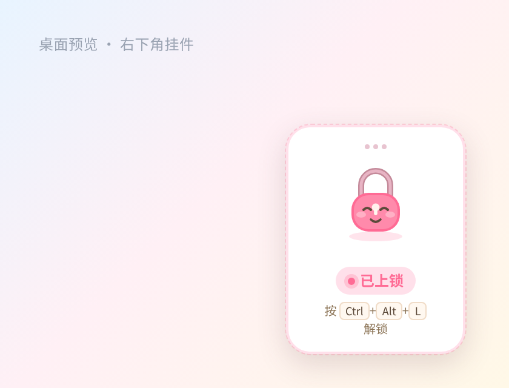
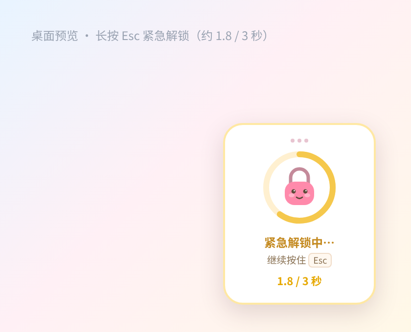
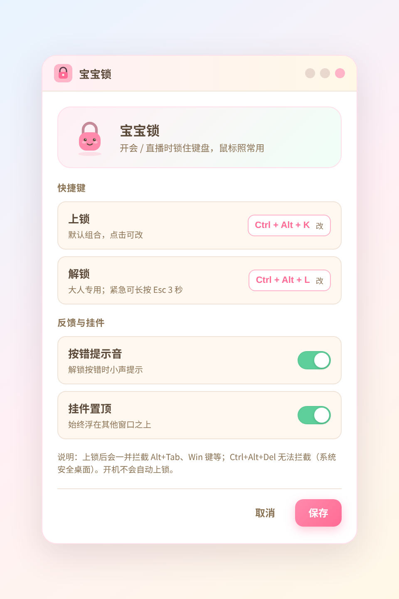
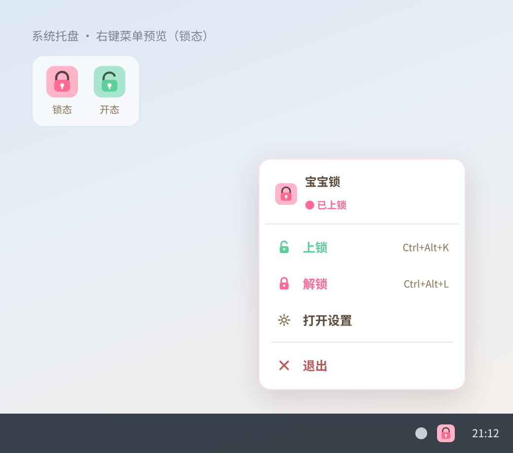
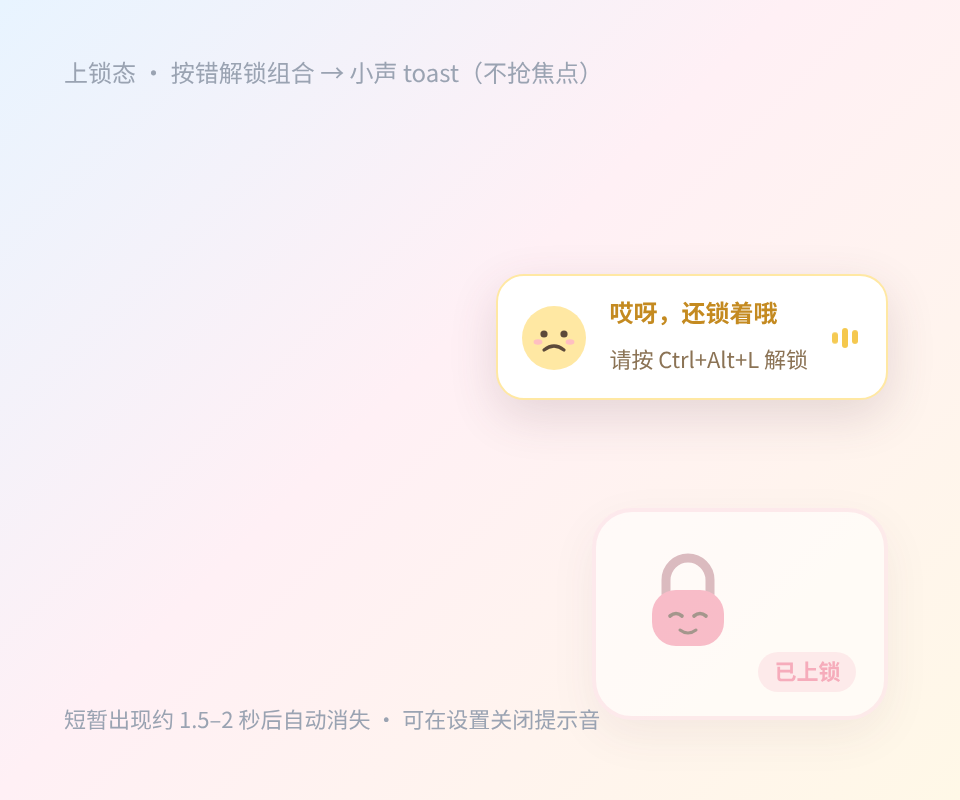

# 宝宝锁

开会或直播时，把键盘暂时锁住，免得小孩凑过来乱按。鼠标和触控板照常使用。

界面是简体中文。当前发布是 **v0.1.1**。

> **v0.1.1 还不能用来上锁。** 安装钩子之后，F23 探测经常不能在按键交给其他程序之前被同步看到（`probe-not-sync`）。热键和托盘里的「上锁」不会进入已上锁。请先看 [已知问题](#known-issues)。修复目标是 **0.1.2**。

<a id="intro"></a>

## 产品介绍

### 简体中文（主文，也是界面语言）

给开会、直播时旁边可能有小孩拍键盘的人用。它是一个独立的 Windows 小工具：你自己决定什么时候锁、什么时候开，开机不会自己锁上，也不和「专注守卫」联动。

| | |
| --- | --- |
| 产品名 | 宝宝锁（开始菜单、安装包显示名） |
| 进程名 | `BaobaoLock.exe` |
| 仓库 | [baobao-lock](https://github.com/passwordis42/baobao-lock) |
| 角色 | 「锁宝」：圆锁、腮红、简笔五官（原创，不是现成 IP） |

**会做**

- 上锁后拦住键盘，包括 Alt+Tab、Win 键，避免切走窗口。
- 默认 `Ctrl+Alt+K` 上锁、`Ctrl+Alt+L` 解锁，可以在设置里改。
- 紧急出口：长按 `Esc` 满 3 秒解锁。
- 右下角可拖的小挂件（可跨屏，位置会记住）。未上锁时没有这块挂件。
- 托盘菜单、设置（改键、按错提示音、挂件置顶）。
- 解锁组合按错时，不抢焦点地提示「哎呀，还锁着哦」。

**不做**

- 不锁鼠标，不锁触控板，不全屏挡住桌面。
- 不写入开机启动，打开后停在托盘，不会自动上锁。
- 不和专注守卫、日历或其他软件联动；没有家长密码。
- 没有 macOS、Linux、手机版。
- `Ctrl+Alt+Del` 在系统安全桌面，拦不住。设置里写了这一点。
- 钩子没真正生效时，不会显示已上锁，也不会假装键盘已经锁住。

需求原文：[docs/PRD.md](docs/PRD.md)。

### English

Baobao Lock is a small Windows tool for meetings and live streams. It locks the keyboard so a child bumping the keys does not type into your call or stream. The mouse and trackpad keep working.

You lock and unlock it yourself. It does not lock on startup, and it is not connected to Focus Guard.

| | |
| --- | --- |
| Name | 宝宝锁 (Baobao Lock). The app UI is Simplified Chinese. |
| Lock | Swallows keys, including Alt+Tab and the Windows key. |
| Unlock | `Ctrl+Alt+L` by default, or hold `Esc` for 3 seconds. |
| Widget | A small draggable corner character（锁宝）while locked. |
| Out of scope | No mouse/trackpad lock, no fullscreen cover, no parental password, no macOS or phone build, no `Ctrl+Alt+Del` block. |
| Honest failure | If the keyboard hook is not actually swallowing keys, the app says so and does not show a locked state. |

**v0.1.1 cannot lock the keyboard.** See [Known issues](#known-issues).

### 繁體中文（短述）

開會或直播時只鎖鍵盤，避免小孩亂按；滑鼠與觸控板仍可用。畫面文字是簡體中文。**v0.1.1 還不能上鎖**，請先看[已知問題](#known-issues)。

### 日本語（短述）

会議や配信のあいだ、キーボードだけをロックして、子どもの誤操作を防ぎます。マウスとトラックパッドはそのまま使えます。画面の文言は簡体字中国語です。**v0.1.1 ではロックできません。** [既知の問題](#known-issues)を先に見てください。

<a id="download"></a>

## 下载 / Download

只提供 **Windows 10 / 11 的 64 位**安装包。没有 32 位，也没有 macOS。

| | |
| --- | --- |
| 最新标签 | **[v0.1.1](https://github.com/passwordis42/baobao-lock/releases/tag/v0.1.1)**（2026-10-28：能安装，**不能上锁**） |
| 这一版的安装包 | [Baobao-Lock-Setup-0.1.1.exe](https://github.com/passwordis42/baobao-lock/releases/download/v0.1.1/Baobao-Lock-Setup-0.1.1.exe) |
| 以后的版本 | [Releases](https://github.com/passwordis42/baobao-lock/releases)（文件名一般是 `Baobao-Lock-Setup-x.y.z.exe`） |

安装包没有代码签名。Windows SmartScreen 可能提示「未知发布者」。这是未签名安装包的常见提示，不代表锁已经生效。

安装到当前用户目录，默认不用管理员。装完可以立刻打开；打开后只出现托盘图标，**不会上锁**，也不会写入开机启动项。

<a id="known-issues"></a>

## 已知问题 / Known issues

状态日期：**2026-10-28**（Asia/Shanghai）  
最新 Release：**v0.1.1**。这一版**不能用来上锁**。

发版时只改这一节，按下面五步对一下事实：

1. 这一版仍然存在的问题留在「当前开放」，写上版本号和用户能看到的现象。
2. 这一版修好的问题从「当前开放」删掉，在「已修复」加一行：哪一版出现、哪一版修好、一句话原因。
3. 开放列表空了就写「无」。不要留过期条目。
4. 把上面的状态日期、最新 Release，以及文首的提示，改成这一版的日期和 tag。
5. 还没发布的修复只写在「下一步」，不要提前写成「已修复」。

### 当前开放 / Open

| ID | 版本 | 现象 | 下一步 |
| --- | --- | --- | --- |
| `probe-not-sync` | **v0.1.1（当前）** | 钩子句柄有时能装上，但安装时发出的 F23 探测键不能在 `keybd_event` 返回之前、于钩子回调里被同步看到。程序因此**不上锁**，并弹出对话框，标题「键盘钩子未生效」，正文「键盘现在没有锁住」，详情说明探测键没有被同步拦住。热键 `Ctrl+Alt+K` 和托盘「上锁」都不会进入已上锁，看起来像没有反应。 | 修复进行中，目标 **0.1.2**，分支 `fix/windows-hook-probe-sync`。0.1.2 发布前，不要把 v0.1.1 当成能用的上锁工具。 |

v0.1.1 上以管理员身份再运行一次，**不能**把上面这条写成已修好。钩子失败时程序仍会建议可以试一次管理员运行；那是通用提示，不是这条 bug 的修复。

**English.** On v0.1.1 the low-level hook may be installed, but the F23 install probe is not observed synchronously inside the hook callback before other apps can see the key (`probe-not-sync`). Lock never starts. The app shows 「键盘钩子未生效 / 键盘现在没有锁住」 and does not pretend the keyboard is locked. Hotkeys and the tray lock action therefore look like they do nothing. A fix is in progress toward 0.1.2 on `fix/windows-hook-probe-sync`. Do not treat v0.1.1 as a working lock.

### 已修复 / Fixed

| ID | 出现 | 修复于 | 说明 |
| --- | --- | --- | --- |
| `loadApi` 第二次安装返回 `undefined` | v0.1.0 | **v0.1.1** | 再次安装钩子时，已加载的 `kernel32` 被弄丢，`loadApi` 第二次返回 `undefined`，详情变成 `Cannot read properties of undefined (reading 'func')`。这是程序内部错误，键盘当时也没有锁上。0.1.1 改为把已加载的 `user32` / `kernel32` 缓存下来再返回。 |

**English.** v0.1.0: a second hook install dropped the cached `kernel32`, so `loadApi` returned `undefined` and the dialog showed `reading 'func'`. Fixed in v0.1.1. That release still cannot lock, because of `probe-not-sync` above.

<a id="usage"></a>

## 怎么用 / Usage

先看 [已知问题](#known-issues)。在 `probe-not-sync` 修好之前，下面的「上锁」不会进入已上锁。

| 动作 | 默认操作 |
| --- | --- |
| 打开菜单 | 左键或右键托盘图标。未上锁是薄荷绿，已上锁是粉色，钩子没生效会标明「钩子未生效」。 |
| 上锁 | `Ctrl+Alt+K`（设置里可改） |
| 解锁 | `Ctrl+Alt+L`，或长按 `Esc` 满 3 秒（挂件上出现黄色进度环） |
| 上锁之后 | 键盘（含 Alt+Tab、Win）被拦住。鼠标可以拖挂件，位置会记住，也能拖到另一块屏幕。 |
| 解锁组合按错 | 出现「哎呀，还锁着哦」，不抢焦点。提示音可以关掉。 |
| 系统退路 | `Ctrl+Alt+Del` 拦不住。 |

改键时，`Esc` 留给紧急解锁，不能设成快捷键。`Ctrl+Alt+Del` 也不能设成快捷键。

**English.** Tray: mint when unlocked, pink when locked. Lock `Ctrl+Alt+K`, unlock `Ctrl+Alt+L` or hold Esc for 3 seconds. A wrong unlock chord shows the toast 「哎呀，还锁着哦」. On v0.1.1 these lock actions do not enter the locked state; see Known issues.

<a id="ui"></a>

## 界面 / UI

界面按医生已确认的 [UI v0](docs/design/v0/README.md) 实现（确认记录：[docs/design/v0/APPROVED.md](docs/design/v0/APPROVED.md)）。下面的图是 `docs/design/v0/` 里的设计稿，GitHub 上可以直接看。

奶油底、浅粉和薄荷绿。角色是「锁宝」。没有暗色模式。未上锁时不放桌面挂件，只有托盘。

| 屏幕 | 说明 |
| --- | --- |
| 挂件 · 已上锁 | 角落可拖；徽章「已上锁」；提示解锁键 |
| 挂件 · 紧急解锁 | 长按 Esc 时用圆环，不用底部进度条 |
| 设置 | 改上锁/解锁键、提示音、挂件置顶；标题「宝宝锁」 |
| 托盘 | 薄荷绿未上锁 / 粉色已上锁；菜单里有上锁或解锁、设置、退出 |
| Toast | 「哎呀，还锁着哦」，不抢焦点 |

| 已上锁 | 紧急解锁 |
| --- | --- |
|  |  |

| 设置 | 托盘菜单 |
| --- | --- |
|  |  |

按错解锁时的提示：



色板和各屏说明见 [docs/design/v0/README.md](docs/design/v0/README.md)。图标源文件是 `src/assets/icon-locked.svg`、`src/assets/icon-unlocked.svg`。

<a id="how"></a>

## 怎么实现 / How it works

界面是 Electron。真正拦键盘的是主进程：用 [koffi](https://koffi.dev/) 调用 `SetWindowsHookExW(WH_KEYBOARD_LL)`。不挂鼠标钩子。

钩子回调必须在这一次按键交给其他程序之前就决定吞不吞。如果把决定推迟到之后的事件循环，键已经送出去了，再画一个「已上锁」就是假的。所以每次安装钩子都会发一个平时打不出字的探测键（F23）。只有回调在 `keybd_event` 返回之前看到这下探测，才算装上。看不到就卸掉钩子，并弹出「键盘钩子未生效 / 键盘现在没有锁住」。v0.1.1 卡在这一步，见 [已知问题](#known-issues) 的 `probe-not-sync`。

权限是 `asInvoker`：默认不用管理员，安装到当前用户目录。失败时可以再试一次「以管理员身份运行」，但程序不会把失败显示成已上锁。

和专注守卫没有联动，也不读它的状态。

更细的打包和钩子说明在 [docs/BUILD.md](docs/BUILD.md)，产品边界在 [docs/PRD.md](docs/PRD.md)。

**English.** Electron UI. The main process installs a low-level keyboard hook with koffi and `SetWindowsHookExW(WH_KEYBOARD_LL)`, then checks with an F23 probe that the callback saw the key synchronously. The manifest is `asInvoker` (no admin by default). Failure stays an error dialog, never a fake lock. Not linked to Focus Guard. Depth: [docs/BUILD.md](docs/BUILD.md), [docs/PRD.md](docs/PRD.md).

<a id="build"></a>

## 构建 / Build

在 64 位 Windows 上，Node.js 20 或更新版本：

```bash
npm ci
npm test
npm run dist
```

产物是 `release/Baobao-Lock-Setup-<version>.exe`。`npm test` 不挂键盘钩子，macOS / Linux 上也能跑。签名、SmartScreen、koffi 打进安装包的注意点都写在 [docs/BUILD.md](docs/BUILD.md)。

CI（`.github/workflows/windows-setup.yml`）会跑测试并上传安装包构建产物，不会自动创建 GitHub Release。对外下载以 [Releases](https://github.com/passwordis42/baobao-lock/releases) 为准。

<a id="license"></a>

## 许可与隐私 / License and privacy

仓库根目录目前没有 `LICENSE` 文件。在补上许可证之前，不要把它当成可以自由复制或再发布的开源授权。

程序不联网，也不上传按键。快捷键、提示音开关和挂件位置写在本机的 `settings.json`（Electron `userData`）。同目录的 `baobao.log` 只记钩子安装成败和错误摘要，不记你按下的普通键。
